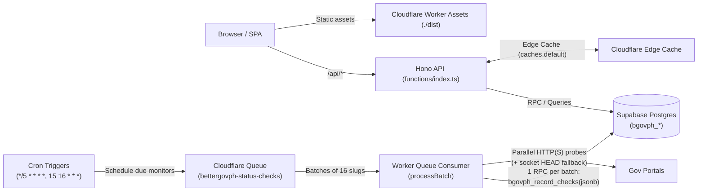

# BetterGovPH Status

Source code of **BetterGovPH Status**, an edge-native uptime and performance monitor for Philippine government online portals and services — built on Cloudflare Workers and Supabase, following the design system and repository structure of [BetterGov.ph](https://github.com/bettergovph/bettergov).

## About this project

BetterGovPH Status tracks the availability and latency of critical citizen-facing portals (such as BIR, SSS, PhilHealth, Pag-IBIG, PSA, DFA, and LTO) alongside agency websites from the BetterGov.ph directory.

Goals:

- Real-time visibility into Philippine government online service availability
- Edge-native execution on Cloudflare Workers with low operational cost
- Transparent, open-source monitor definitions reviewed via pull requests
- Accessible, readable public status UI matching the BetterGov.ph design system
- Extensible check architecture ready for keyword, TLS, DNS, and TCP checks

## Features

- Tiered check intervals: **5 minutes** for the **31 curated Critical** citizen portals (`src/data/monitors/curated.json`), **15 minutes** for standard agency websites (`src/data/monitors/imported/*.json`), plus a daily cleanup cron at `16:15 UTC` (`00:15 Asia/Manila`) to prune raw checks older than 30 days
- Uptime Kuma-style 24-hour / 45-day / 90-day uptime bars with color-coded status legend (Operational, Degraded / partial outage, Probe Blocked (WAF), Down / Under Maintenance, No data) and response-time charts (`24h`, `7d`, `30d`, `90d`)
- Quick **All / Critical** tier toggle and clickable overall status filters on the homepage, plus dedicated `/about` methodology & agency allowlisting documentation
- 2-strike incident detection (1st failed check immediately marks the portal **Down** with its cause sub-status such as `Down · Timeout`, while an incident opens on 2 consecutive `down` checks and resolves on 2 consecutive non-down checks) with human-readable cause explanations
- Data-as-code monitor definitions validated by JSON Schema
- Hono-powered Cloudflare Worker API with edge-cached responses (`Cache-Control: s-maxage=60`) to absorb public traffic

### Incident causes

When a monitor fails two consecutive checks, an incident is recorded with one of the following causes (displayed with plain-English explanations in the UI):

| Code                                | Display Label             | Explanation                                                                                       |
| ----------------------------------- | ------------------------- | ------------------------------------------------------------------------------------------------- |
| `not_found`                         | Page Not Found (HTTP 404) | Server responded with HTTP `404`; the monitored page may have moved or been removed.              |
| `unexpected_status` / `http_<code>` | Unexpected HTTP Error     | Server returned another failing HTTP status code (e.g., `5xx` or `4xx`).                          |
| `maintenance`                       | Under Maintenance         | HTML response matched a maintenance notice.                                                       |
| `keyword_missing`                   | Expected Content Missing  | Page loaded but did not contain the configured `expectedKeyword`.                                 |
| `timeout`                           | Request Timed Out         | Server did not respond within the check timeout window (15s default).                             |
| `dns`                               | DNS Resolution Failed     | Domain name could not be resolved to an IP address.                                               |
| `tls`                               | TLS / SSL Error           | HTTPS connection failed due to a TLS handshake or certificate error.                              |
| `connect`                           | Connection Failed         | Probe could not establish a network connection to the server.                                     |
| `invalid_http_header`               | Malformed HTTP Response   | Server returned invalid HTTP headers and the socket `HEAD` fallback could not read a status line. |

## How to Run

```bash
# Install packages
npm install

# Copy local Worker secrets (already pre-configured for local Supabase)
cp .dev.vars.example .dev.vars

# Apply database migrations to local Supabase (bgovph_* objects only)
npm run db:migrate:local
```

Start the frontend and the Worker in two terminals:

```bash
# Terminal 1 — Cloudflare Worker on 127.0.0.1:5525
npm run functions:dev

# Terminal 2 — Vite SPA on http://localhost:5125 (proxies /api/* to Worker)
npm run dev
```

**Access the application at:** `http://localhost:5125`

### Triggering checks locally

Local development does not run the 5-minute cron automatically. You can trigger a check cycle manually in either of two ways:

1. Run `npm run check:trigger` for a one-off critical-tier run, `npm run check:watch` to run critical checks every 5 minutes, or `npm run check:watch:all` to also cycle through all standard-tier monitors every 15 minutes.
2. Call Wrangler's scheduled endpoint: `curl "http://127.0.0.1:5525/__scheduled?cron=*/5+*+*+*+*"`

## Monitor data

Monitor definitions live in committed JSON files validated by JSON Schema:

| File                                | Holds                                                       | Schema                                   |
| ----------------------------------- | ----------------------------------------------------------- | ---------------------------------------- |
| `src/data/categories.json`          | Category taxonomy                                           | `src/data/schema/categories.schema.json` |
| `src/data/monitors/curated.json`    | High-traffic citizen portals (`critical` tier, 5m)          | `src/data/schema/monitors.schema.json`   |
| `src/data/monitors/imported/*.json` | Agency sites imported from BetterGov (`standard` tier, 15m) | `src/data/schema/monitors.schema.json`   |

Edit them in a pull request like any other data file. Validate locally with:

```bash
npm run validate:data
```

See [the monitor data notes](src/data/monitors/README.md) for field rules, naming conventions, and agency opt-out instructions.

## Importing from BetterGov

`npm run import:websites` reads `websites.json` from [bettergovph/bettergov](https://github.com/bettergovph/bettergov), normalizes URLs to `https://`, deduplicates against `curated.json`, maps BetterGov `type` values to our categories, and writes deterministic sorted files under `src/data/monitors/imported/`.

```bash
# Refresh from GitHub
npm run import:websites

# Refresh from a local clone and probe each URL once
npm run import:websites -- --input ../bettergov/src/data/websites.json --probe
```

## Architecture

BetterGovPH Status is split between **Cloudflare's edge** (Worker, Static Assets, Queues, Cron Triggers, Rate Limiting, and Edge Cache) and **Supabase Postgres** (storage, incremental rollups, and SQL aggregation RPCs). See [docs/architecture.md](docs/architecture.md) for the quick-reference summary.



### Deployment Architecture

- **Single Cloudflare Worker (`wrangler.jsonc`)**:
  - Serves the built Vite/React SPA from `./dist` with `not_found_handling: "single-page-application"`.
  - Intercepts `/api/*` first (`run_worker_first: ["/api/*"]`) via the Hono app in `functions/index.ts`.
  - Defines both production (`bettergovph-status`) and `staging` (`bettergovph-status-staging`) environments.
- **Cloudflare Queues (`CHECK_QUEUE`)**:
  - Producer/consumer queue `bettergovph-status-checks` (`max_batch_size: 1`, `max_retries: 1`) decouples cron scheduling from probe execution so hundreds of monitors can be checked without hitting per-invocation subrequest limits.
- **Cloudflare Cron Triggers**:
  - `*/5 * * * *`: Enqueues due monitors (`critical` every 5m, `standard` when `UTC minute % 15 === 0`).
  - `15 16 * * *` (`00:15 Asia/Manila`): Runs daily retention pruning (`bgovph_prune_checks(30)` and `bgovph_prune_daily_stats(365)`).
- **Edge Security & Rate Limiting**:
  - `API_RATE_LIMITER` enforces **120 requests / 60s** per `CF-Connecting-IP` (`429` with `Retry-After: 60`).
  - Origin/CORS middleware (`functions/lib/request-security.ts`) restricts browser origins to `bettergov.ph`, `*.bettergov.ph`, `*.workers.dev`, and `localhost`/`127.0.0.1`.
- **Supabase Postgres (Singapore `ap-southeast-1` recommended)**:
  - All database objects use the `bgovph_` prefix, have Row Level Security (RLS) enabled, and expose `SECURITY DEFINER` RPC functions with `public`, `anon`, and `authenticated` privileges revoked.
  - Accessed exclusively from the Worker using `SUPABASE_URL` and `SUPABASE_SERVICE_ROLE_KEY` secrets.
- **CI Pipeline (`.github/workflows/build-test.yml`)**:
  - Runs `validate:data`, `typecheck`, `lint`, `test:unit`, and `build` on every push to `main` and every pull request.

### Technical Architecture

- **Worker Entrypoints (`functions/index.ts`)**:
  - `fetch`: Hono API router (`/api/summary`, `/api/dashboard`, `/api/monitors`, `/api/monitors/:slug`, `/api/monitors/:slug/history`, `/api/incidents`, `/api/trigger`).
  - `scheduled`: Dispatches `runCycle(env)` on `*/5 * * * *` or daily pruning on `15 16 * * *`.
  - `queue`: Consumes `CHECK_QUEUE` messages via `processBatch(slugs, env)`.
- **Batch Scheduling & Subrequest Budget (`functions/lib/scheduler.ts`)**:
  - `selectDueMonitors` picks `critical` monitors every run and adds `standard` monitors when `UTC minute % 15 === 0`.
  - Slugs are chunked into batches of `BATCH_SIZE = 16` and dispatched via `CHECK_QUEUE.sendBatch(...)`. When `CHECK_QUEUE` is unbound (e.g., local dev), `runCycle` falls back to inline execution capped at 1 batch of 16 monitors.
  - Each consumer invocation runs `Promise.allSettled` across its batch and persists all results in **one** `bgovph_record_checks(jsonb)` RPC call, keeping subrequests well below Cloudflare's 50-subrequest limit.
- **HTTP(S) Probe & Resilience (`functions/checks/http.ts`)**:
  - Enforces bounded redirects (`MAX_REDIRECTS = 2`), reads up to `16 KB` (`16_384` bytes) of response body to detect maintenance phrases or `expectedKeyword`, and classifies WAF `403` responses (`waf_403`) as `degraded`.
  - If `fetch()` rejects malformed HTTP headers (e.g., legacy IIS servers), falls back to a raw `cloudflare:sockets` `HEAD` request to read the HTTP status line.
- **2-Strike Incident State Machine (`functions/lib/state.ts`, `bgovph_record_checks`)**:
  - The 1st `down` check immediately updates `bgovph_monitor_state.status` to `down`.
  - **2 consecutive `down` checks** open an incident in `bgovph_incidents`; **2 consecutive non-down (`up` | `degraded`) checks** resolve it.
- **API Edge Caching**:
  - `/api/summary`: `Cache-Control: public, max-age=30, s-maxage=60`.
  - `/api/dashboard`: Uses Cloudflare Edge Cache (`caches.default`) keyed by `range` and `tier` with `Cache-Control: public, max-age=300, s-maxage=300, stale-while-revalidate=60` so cache hits incur zero Supabase egress.
  - `/api/monitors/:slug/history`: `Cache-Control: public, max-age=60, s-maxage=300`.

### Data & Aggregation Architecture

Aggregation is split between **write-time incremental rollups** in Postgres and **read-time SQL RPCs** so public dashboard and status requests never scan unbounded raw check logs.

#### 1. Write-Time Aggregation (`bgovph_record_checks`)

Every queue batch executes a single atomic transaction in `bgovph_record_checks(p_results jsonb)`:

1. **Raw check append (`bgovph_checks`)**: Inserts each probe result (`monitor_slug`, `checked_at`, `status`, `http_status`, `response_ms`, `error`, `colo`). Retained for **30 days**.
2. **Asia/Manila daily rollup (`bgovph_daily_stats`)**: Computes `v_day = (checked_at at time zone 'Asia/Manila')::date` and upserts `(monitor_slug, day)` counters:
   - `total`, `up`, `degraded` (excluding `waf_403`), `waf` (`status = 'degraded'` with `error = 'waf_403'`), `down`, `sum_ms`, and `max_ms = greatest(...)`.
   - Retained for **365 days**.
3. **Current state & incidents (`bgovph_monitor_state`, `bgovph_incidents`)**: Locks the monitor's state row (`FOR UPDATE`), advances `consecutive_fail` / `consecutive_ok`, and opens or resolves incidents under the 2-strike rule.

#### 2. Read-Time Aggregation

| Endpoint                          | Source / RPC                                                  | How Data Is Aggregated                                                                                                                                                                                                                                                                                                                                                                                                                                                                                 |
| --------------------------------- | ------------------------------------------------------------- | ------------------------------------------------------------------------------------------------------------------------------------------------------------------------------------------------------------------------------------------------------------------------------------------------------------------------------------------------------------------------------------------------------------------------------------------------------------------------------------------------------ |
| `GET /api/summary`                | `bgovph_get_summary()` (`functions/lib/snapshot.ts`)          | Single SQL RPC returning: current `states` from `bgovph_monitor_state`; rolling 24h uptime & average latency (`u24` from `bgovph_checks`); 24h hourly bars (`hourly_24h` via `date_trunc('hour', checked_at)` on `bgovph_checks`, separating `up`, `degraded`, `waf`, `down`, `avgMs`); 90-day daily bars (`bars_90d` from `bgovph_daily_stats`); and `openIncidents`.                                                                                                                                 |
| `GET /api/dashboard`              | `bgovph_get_dashboard(p_days)` (`functions/api/dashboard.ts`) | SQL RPC aggregates `bgovph_daily_stats` and `bgovph_incidents` over `7d`, `30d`, `90d`, or `1y` (clamped `1..365` days) into per-monitor totals, daily network trends, incident counts, top 10 causes, and MTTR (`avgResolutionSec`). The Worker (`buildDashboardPayload`) filters by `tier` (`all` \| `critical` \| `standard`), computes availability/clean-uptime/WAF/degraded/down percentages, rolls up category leaderboards, and ranks top-10 best, worst, slowest, and most-incident monitors. |
| `GET /api/monitors/:slug/history` | `fetchMonitorHistory()` (`functions/lib/supabase.ts`)         | For `24h`, `7d`, and `30d`, queries `bgovph_checks` (limit 1,000) and downsamples evenly to at most **200 points** for chart readability. For `90d`, switches to `bgovph_daily_stats` so 90-day charts remain complete even after raw checks are pruned at 30 days.                                                                                                                                                                                                                                    |

#### 3. Retention & Pruning

- `15 16 * * *` UTC (`00:15 Asia/Manila`) runs `bgovph_prune_checks(30)` to delete raw rows from `bgovph_checks` older than 30 days and `bgovph_prune_daily_stats(365)` to delete daily rollups older than 365 days.

## Database (Supabase)

All database objects use the `bgovph_` prefix so local development can safely share a local Supabase instance without touching existing tables. Raw checks are retained for **30 days** and daily rollups (`bgovph_daily_stats`) for **365 days**, both pruned by the daily Worker cron.

See [the Supabase notes](supabase/README.md) for local reset (`npm run db:down:local`) and staging/production setup.

## Deploying

1. Create dedicated Supabase projects for staging and production (Singapore `ap-southeast-1` region recommended).
2. Apply all migrations in `supabase/migrations/` in order (`20261124000000_bgovph_init.sql`, `20261124000001_bgovph_waf_bars.sql`, `20261125000000_bgovph_dashboard.sql`) to each project.
3. Provision the Cloudflare Queue (`bettergovph-status-checks`, bound as `CHECK_QUEUE` in `wrangler.jsonc`).
4. Set secrets with `wrangler secret put SUPABASE_URL` and `wrangler secret put SUPABASE_SERVICE_ROLE_KEY`.
5. Deploy:

```bash
npm run deploy
```

## Testing

This project uses Vitest for unit/data tests and Playwright (with axe-core) for end-to-end and accessibility tests. See [the Testing Guide](./TESTING.md).

## Contributing

Contributions are welcome — new monitor proposals, URL corrections, check types, UI improvements, and documentation. Please see [the Contributing Guide](./CONTRIBUTING.md).

## Code of Conduct

Please read our [Code of Conduct](./CODE_OF_CONDUCT.md) before participating.

## License

- **Code** is released under the [MIT License](./LICENSE).
- **Imported directory data** is adapted from [bettergovph/bettergov](https://github.com/bettergovph/bettergov), whose content is published under CC BY-NC-ND 4.0.
