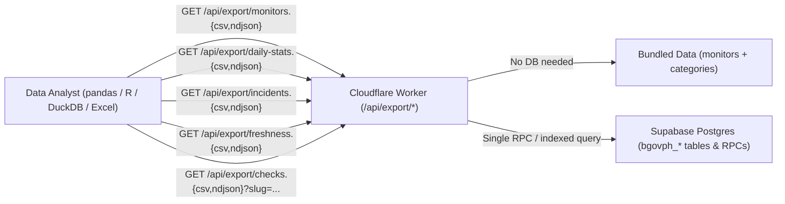

# Implementation Plan: Public Data-Analyst-Friendly Exports & Open Data Surface

## Goal Description

BetterGovPH Status already exposes a rich JSON API, OpenAPI 3.1 spec, and LLM-friendly Markdown surface (`/llms.txt`, `/status.md`, `*.md`). However, **data analysts** (using Python/pandas/polars, R, DuckDB, Excel/Google Sheets, Observable, or BI tools) currently face several friction points:

1. **Nested JSON & pagination**: `/api/summary` nests 90-day and 24-hour bar arrays inside each monitor object, and `/api/incidents` is paginated at 25 rows per page.
2. **Silent downsampling**: `/api/monitors/:slug/history` caps raw checks at `1000` rows and downsamples to `<= 200` points for UI charts, which distorts statistical analysis.
3. **No bulk multi-monitor time-series endpoint**: Analysts must loop over hundreds of monitors individually (risking the 120 req/min rate limit) to build a flat table of daily uptime/latency across agencies.
4. **No tabular formats or data dictionary**: There are no `text/csv` or `application/x-ndjson` (JSON Lines) endpoints, nor a formal codebook/schema explaining units, timezones (`Asia/Manila` vs `UTC`), WAF semantics (`waf_403`), or retention windows.

This plan introduces a **tidy, flat, public Open Data export layer** under `/api/export/*` (supporting CSV and NDJSON), removes the need for analysts to scrape paginated/nested endpoints, documents the dataset with a machine- and human-readable Data Dictionary, and surfaces download links & code snippets in the UI.

---

## Constraints & Compatibility

- **Cloudflare Worker & Supabase Constraints**:
  - All new endpoints must stay well within Cloudflare Workers free-tier limits (50 outbound subrequests, 128 MB memory, CPU time limits).
  - Cross-monitor daily rollups (`bgovph_daily_stats`, ~200+ monitors × up to 365 days) can be exported in bulk, whereas raw per-check rows (`bgovph_checks`, millions of rows over 30 days) should be scoped **per monitor** (or per single day) with explicit date/cursor parameters rather than an unbounded full-table dump.
- **No Breaking Changes**: All existing `/api/*` JSON and Markdown endpoints remain untouched and backwards-compatible. New functionality lives under `/api/export/*` and `/about` (or a dedicated `/data` section), and is registered in `functions/agent/openapi.ts`, `functions/agent/llms.ts`, and `vite.config.ts` per `AGENTS.md`.

---

## Open Questions to Decide Before Implementing

1. **Export Formats**: Is **CSV (RFC 4180)** + **NDJSON (`application/x-ndjson`)** sufficient for Phase 1, or should we also add a static/GitHub-Actions-generated **Parquet** snapshot? (Cloudflare Workers cannot easily encode Parquet in-memory without heavy WASM; CSV + NDJSON work natively in pandas, polars, R, Excel, and DuckDB `read_csv` / `read_ndjson`.)
2. **Raw Check Bulk Access**: For `bgovph_checks` (30-day retention), prefer:
   - *(Recommended)* Per-monitor un-downsampled export (`/api/export/checks.csv?slug=bir-orus&from=...&to=...`), **plus** a single-day cross-monitor export (`?day=YYYY-MM-DD`, ~80k rows max) with cursor pagination?
   - Or per-monitor only?
3. **Open Data License**: `LICENSE` in the repo is MIT (for software). For the public **dataset** itself, should `openapi.json` and the Data Dictionary declare **CC0 1.0 (Public Domain)** or **CC-BY 4.0** (attribution to BetterGovPH Status)?
4. **UI Discoverability**: Add an **"Open Data & Exports"** section on `/about` plus quick **"Export CSV"** buttons on the Dashboard (`/`) and Incidents (`/incidents`) pages, or create a dedicated `/data` page?

---

## Proposed Changes



---

### 1. Serialization & Formatting Utilities (`functions/lib/`)

Create a lightweight, zero-dependency RFC 4180 CSV and NDJSON serializer that handles `null` values, quoting, optional UTF-8 BOM, and proper `Content-Type` / `Content-Disposition` / `Cache-Control` headers.

#### [NEW] `functions/lib/export-format.ts`
- `parseExportFormat(c, defaultFormat = 'csv')`: Supports both path suffix (`.csv` / `.ndjson`) and `?format=csv|ndjson`.
- `toCsv(columns, rows)`:
  - RFC 4180 compliant quoting (escapes `"`, wraps fields containing `,`, `"`, `\n`, `\r`).
  - Renders `null` / `undefined` as empty string `""` (standard for pandas/R `NA` parsing).
  - Optional `?bom=1` query param to prepend UTF-8 BOM (`\uFEFF`) for Excel users opening Filipino agency names with accents/enye.
- `toNdjson(rows)`: One `JSON.stringify(row)` per line (`\n`-delimited).
- `exportResponse(c, { filename, format, columns, rows, cacheControl })`: Sets `Content-Type` (`text/csv; charset=utf-8` or `application/x-ndjson; charset=utf-8`), `Content-Disposition: attachment; filename="..."` (when `?download=1` or `.csv` requested), and edge caching headers.

---

### 2. Database Queries & Migration (`supabase/migrations/` & `functions/lib/supabase.ts`)

Add a single-RPC helper for bulk daily stats filtering (by date range and optional `slug`) and un-downsampled per-monitor raw checks export so Worker subrequests stay at `1` per API call.

#### [NEW] `supabase/migrations/20261127000000_bgovph_export_rpcs.sql`
- Prefix all objects with `bgovph_` (enforced by `functions/__tests__/migrations-prefix.test.ts`).
- `bgovph_export_daily_stats(p_from date, p_to date, p_slug text default null)`:
  - Queries `bgovph_daily_stats` filtered by date range (`<= 365` days) and optional `monitor_slug`, ordered by `day asc, monitor_slug asc`.
  - Returns raw counts (`total`, `up`, `degraded`, `waf`, `down`, `sum_ms`, `max_ms`) so analysts can compute exact weighted aggregations themselves without rounding error.
- `bgovph_export_checks(p_slug text, p_from timestamptz, p_to timestamptz, p_limit integer default 10000)`:
  - Uses existing index `bgovph_checks_slug_time (monitor_slug, checked_at desc)` to return un-downsampled raw check rows for a given monitor and time window (capped at `10,000` rows per request, with `checked_at` cursor support for full 30-day pagination).

#### [MODIFY] `functions/lib/supabase.ts`
- Add `fetchExportDailyStats(env, { from, to, slug })`
- Add `fetchExportIncidents(env, { status, from, to, slug, limit, offset })`
- Add `fetchExportFreshnessEvents(env, { from, to, slug, limit })`
- Add `fetchExportChecks(env, { slug, from, to, limit })`

---

### 3. Public Export Endpoints (`functions/api/export.ts` & `functions/index.ts`)

Expose clean, tidy, flat datasets under `/api/export/*`. Every endpoint supports `.csv` and `.ndjson` (or `?format=csv|ndjson`) and optional filters (`?from=YYYY-MM-DD`, `?to=YYYY-MM-DD`, `?category=...`, `?tier=...`, `?slug=...`).

#### [NEW] `functions/api/export.ts`

1. **`GET /api/export/monitors.csv` (and `.ndjson`)** — *Dimension / Catalog table*
   - Columns: `slug, name, agency, department, category, category_name, tier, source, url, freshness_enabled, status, last_checked_at, last_http_status, last_response_ms, last_error, last_colo, uptime_24h_pct, avg_ms_24h, freshness_status, freshness_content_updated_at, freshness_last_changed_at`
   - Allows analysts to `JOIN` any fact table (`daily-stats`, `incidents`, `checks`, `freshness`) on `monitor_slug`.

2. **`GET /api/export/daily-stats.csv` (and `.ndjson`)** — *Daily rollup fact table (up to 365 days)*
   - Query params: `from` (default: 30 days ago, `YYYY-MM-DD`), `to` (default: today, `YYYY-MM-DD`), `slug`, `category`, `tier`.
   - Columns: `day, monitor_slug, agency, category, tier, total, up, degraded, waf, down, sum_ms, max_ms, avg_ms, availability_pct, clean_uptime_pct`
   - `day` is `Asia/Manila` calendar date (`YYYY-MM-DD`), matching `bgovph_daily_stats`.
   - Edge cached (`Cache-Control: public, max-age=300, s-maxage=600`).

3. **`GET /api/export/incidents.csv` (and `.ndjson`)** — *Outage incidents fact table*
   - Query params: `status=all|open`, `from`, `to`, `slug`, `category`, `tier`.
   - Columns: `id, monitor_slug, monitor_name, agency, category, tier, started_at, resolved_at, duration_sec, is_open, cause`
   - `started_at` / `resolved_at` in ISO-8601 UTC; `duration_sec` precomputed for resolved incidents (`null` if open).

4. **`GET /api/export/freshness.csv` (and `.ndjson`)** — *Content freshness change events (up to 180 days)*
   - Query params: `from`, `to`, `slug`, `category`.
   - Columns: `id, monitor_slug, monitor_name, agency, category, detected_at, signal_source, content_updated_at`

5. **`GET /api/export/checks.csv` (and `.ndjson`)** — *Un-downsampled raw check probes (30-day retention)*
   - Query params: `slug` (required, or `day=YYYY-MM-DD`), `from` (ISO-8601), `to` (ISO-8601), `limit` (default `5000`, max `10000`).
   - Columns: `checked_at, monitor_slug, status, http_status, response_ms, error, colo`
   - Returns `X-Next-Cursor` / `Link: <...>; rel="next"` header when truncated at `limit` so scripts can paginate cleanly without missing a single probe.

6. **`GET /api/export/schema.json`** — *Machine-readable Data Dictionary (Frictionless Table Schema style)*
   - Built from bundled definitions (works even if Supabase is unavailable), describing every export table, column name, type, unit (`ms`, `pct`, `sec`), timezone (`UTC` vs `Asia/Manila`), nullability, enum values, retention period, and license.

#### [MODIFY] `functions/index.ts`
- Mount the `/api/export/*` routes on `api` (with `/export/schema.json` above `requireSupabaseEnv` so it works without DB).

---

### 4. OpenAPI, LLM Docs, & Dev Proxy (`functions/agent/`, `vite.config.ts`)

Per `AGENTS.md`, every new public GET route must be documented in OpenAPI and `llms.txt`, and proxied in Vite dev mode.

#### [MODIFY] `functions/agent/openapi.ts`
- Add OpenAPI 3.1 path definitions for `/api/export/monitors.{format}`, `/api/export/daily-stats.{format}`, `/api/export/incidents.{format}`, `/api/export/freshness.{format}`, `/api/export/checks.{format}`, and `/api/export/schema.json` under an `exports` tag.

#### [MODIFY] `functions/agent/llms.ts`
- Add a `## Bulk Data Exports (CSV / NDJSON)` section to `buildLlmsTxt()` and `buildLlmsFullTxt()` with example `curl` / `duckdb` / `pandas` usage.

#### [MODIFY] `vite.config.ts`
- Update the `/api/` proxy regex to include `export(?:/.*)?`:
  ```ts
  '^/api/(summary|dashboard|monitors(?:/.*)?|incidents(?:\\.md)?|export(?:/.*)?|status\\.md|openapi\\.json)(?:\\?|$)'
  ```

---

### 5. Frontend Discoverability (`src/pages/about/`, `src/pages/dashboard/`, `src/pages/incidents/`)

#### [MODIFY] `src/pages/about/index.tsx`
- Add an **"Open Data & Analyst Exports"** section with:
  - Direct download links for Monitors, Daily Stats (CSV/NDJSON), Incidents, and Freshness Events.
  - Copy-pasteable starter snippets for **Python (pandas / polars)**, **DuckDB**, and **R (`readr`)**.
  - Methodology notes for analysts (2-strike incident rule, `waf_403` vs `down`, `Asia/Manila` daily rollups vs `UTC` timestamps, data retention windows).

#### [MODIFY] `src/pages/dashboard/index.tsx` & `src/pages/incidents/index.tsx`
- Add subtle **"Export CSV"** links (pointing to `/api/export/daily-stats.csv?from=...&to=...&tier=...` and `/api/export/incidents.csv?status=...`) matching the existing `src/components/ui` design system.

---

## Verification Plan

### Automated Tests
1. Add `functions/__tests__/export.test.ts` covering CSV escaping, NDJSON formatting, all `/api/export/*` routes with mocked Supabase responses, validation errors (`400`), and pagination/cursor headers.
2. Existing `functions/__tests__/agent.test.ts` verifies every new GET route is present in `/api/openapi.json`.
3. Existing `functions/__tests__/migrations-prefix.test.ts` verifies all new SQL objects use the `bgovph_` prefix.
4. Run full check suite:
   ```bash
   npm run typecheck && npm run lint && npm run test:unit && npm run build
   ```

### Manual Verification
1. Run `npm run functions:dev` and query `/api/export/monitors.csv`, `/api/export/daily-stats.ndjson`, and `/api/export/schema.json`.
2. Load exported CSV/NDJSON in `pandas` / `duckdb` / Excel to confirm clean types and encoding.
3. Visit `/about`, `/`, and `/incidents` in the browser to confirm export links work and match the UI.
